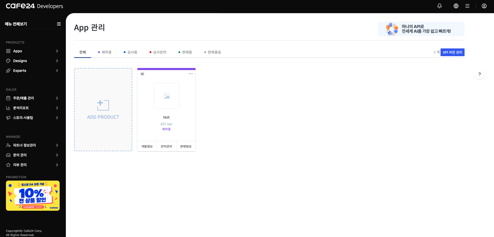

# 카페24란
온라인 쇼핑몰을 운영할 수 있는 플랫폼
쇼핑몰을 생성하면 접속 가능한 기본 도메인이 무료 제공된다.
admin 페이지에서 디자인 > 디자인FTP 에서 ftp를 신청해 접속할 수 있다.

생각보다 기능이 있는듯 없는듯
카페24의 모듈과 정해놓은 변수를 사용해 값을 불러올 수 있는데 모듈안에서 사용이 가능한 변수만 불러올 수 있어 사용이 제한된다.
즉 카테고리모듈에 있는 변수는 그 모듈안에서만 존재하는것이다.

내가 필요한 값을 알기 위해 API를 사용하기로 했다.

## Admin API / Front API
카페24에서 제공하는 API는 크게 Admin API와 Front API로 나뉜다. Admin API는 쇼핑몰 운영(상품·주문·회원 관리 등)에 대한 기능을,
Front API는 쇼핑몰의 프론트단에서 사용되는 기능을 제공한다.
Admin API는 Client Secret으로 토큰을 발급받아 호출하므로 백엔드 서버가 있어야 한다(Secret을 프론트에 노출하면 안 되기 때문). 하지만  내가 필요한 값은 Front API가 가지고 있어 Front API를 사용하기로 했다.
* cafe24 developer
https://developers.cafe24.com/

* cafe24 developer api Docs
https://apidocs.cafe24.com/docs/guide/intro

### 시작하기
로그인 후, CAFE24 Developer Apps 대시보드로 이동 후 좌측 메뉴에서 Apps > App 관리에서 앱을 새로 만든다.

앱이 만들어지면 개발 정보 화면 주소에 
1. Client ID
2. Client Secret Key
3. Front API Key
4. Service Key
를 알 수 있다.
